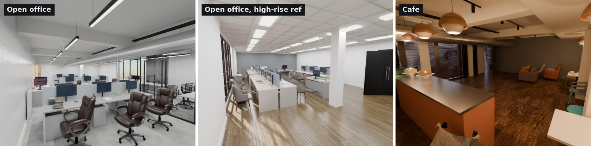
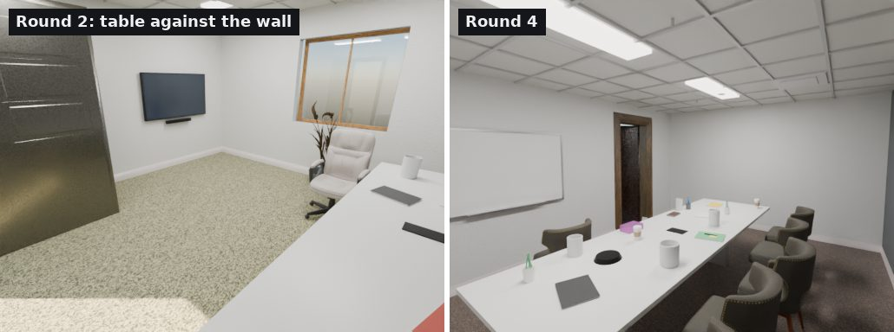
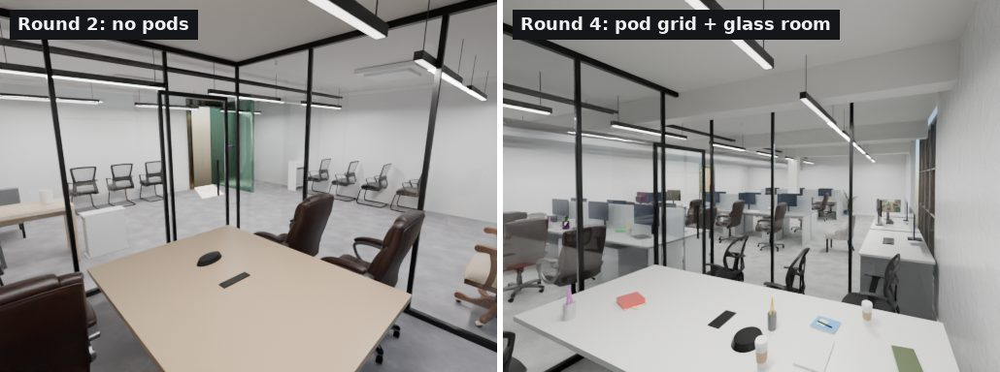
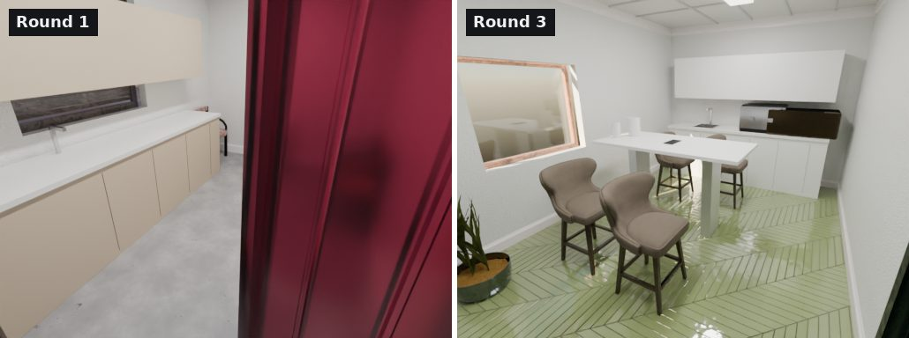
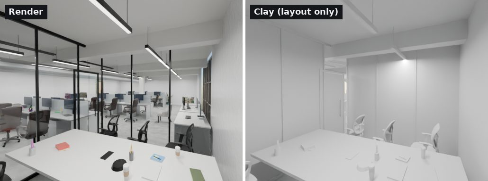
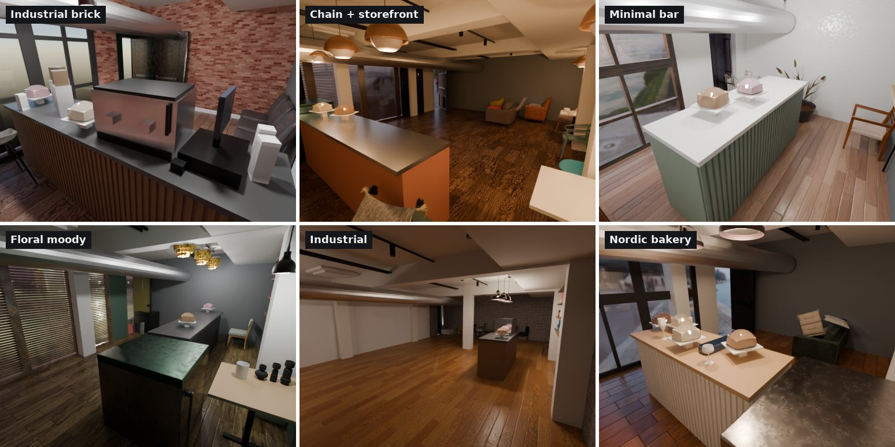
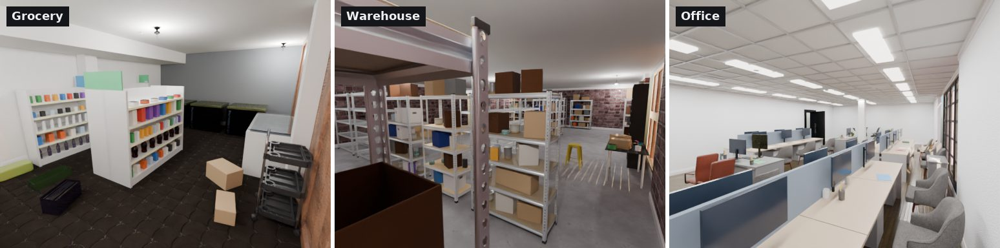
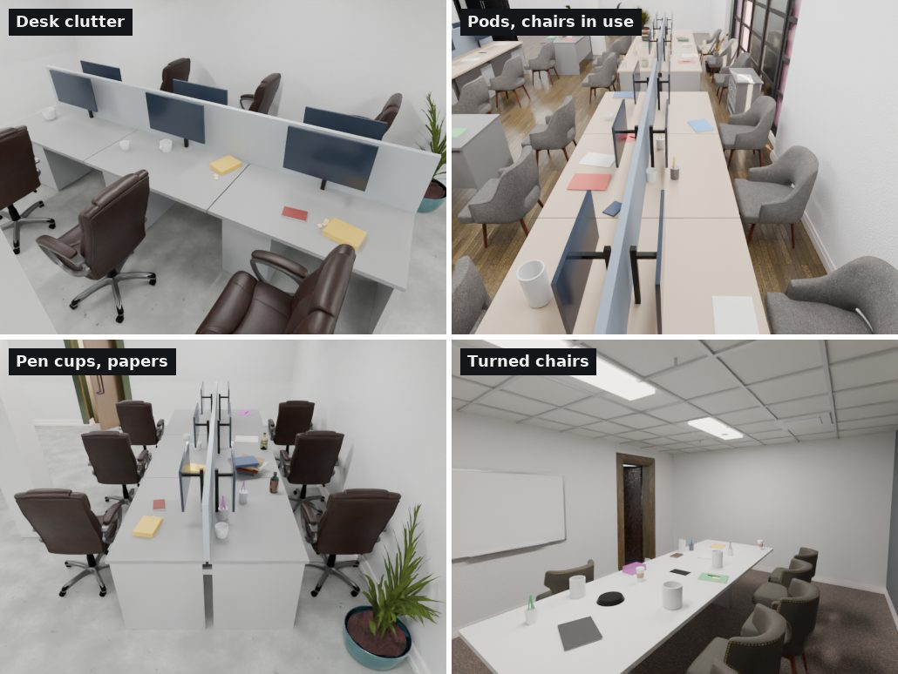

# datagen: procedural interiors that learn from their own critics



**datagen** turns an [Infinigen](https://github.com/princeton-vl/infinigen) floor plan into a furnished, lived-in interior for synthetic RGB / NIR / depth datasets. Infinigen lays out the shell. A language model plans each room. A realizer places procedural and ABO/HSSD assets with real clearances. Lighting, ceilings and materials come from Infinigen 2.0. Every scene is then rendered and judged by an independent critic, and what the critic finds becomes a rule for the generator.

Outputs feed the robomituba IR / OpticalNav datasets.

---

## Pipeline

```mermaid
flowchart LR
    A[floorplan_gen<br/>apartment · office · single room<br/>storefront] --> B[Infinigen layout<br/>doors · windows · walls]
    B --> C[rematerial<br/>Infinigen 2.0 shaders<br/>venue / style / reference]
    C --> D[architecture pass<br/>ceiling grid · linear LEDs<br/>beams · ducts · HDRI]
    D --> E[room planner<br/>Claude plans each room]
    E --> F[realizer<br/>zones · relations · clearance<br/>physics settle]
    F --> G[dressing<br/>desk clutter · turned chairs<br/>fixtures · doors shut]
    G --> H[probe renders<br/>normal + clay]
    H --> I{critic agent}
    I -- rule --> K[(design_knowledge.json)]
    K -. prompt · catalog · realizer .-> E
```



| Stage | Where | What it decides |
|---|---|---|
| Floor plan | `scripts/floorplan_gen.py`, `scripts/infinigen_gen.py` | rooms, doors, windows, storefront glass, room size per venue |
| Materials | `tools/rematerial_rooms_infinigen2.py` | wall / floor shaders per room type, venue, style preset or reference spec |
| Architecture | `tools/architecture_pass.py` | pilasters, beams, soffits, accent walls, office grid ceilings with troffers, linear pendants, exterior HDRI |
| Planning | `tools/room_planner/client.py` | an LLM plan per room: categories, relations, zones, small items, written in the catalog's vocabulary |
| Realizing | `tools/room_planner/realize.py` | where everything goes: wall runs, centre, rows, workstation pod grids, meeting sets, pantry runs, glass meeting rooms, coffee bars |
| Dressing | `realize.py`, `tools/room_dressing.py`, `tools/ceiling_fixtures.py` | desk clutter, seats in use, pendants over service, exterior doors shut |
| Loop | `loop/` | probe views, render + clay, contact sheet, critic brief |

---

## The loop: generate → render → critique → learn

Each round renders fresh layouts, normal and clay, and hands the contact sheet to a critic agent that has not seen earlier rounds. It scores each room 1–10 on six criteria and names the three most damaging problems. Each problem becomes a **general** fix in the generator and a rule in [`room_planner/design_knowledge.json`](tools/room_planner/design_knowledge.json). A rule is promoted from `proposed` to `validated` only when scores rise on *new* seeds.

| Office round | Open office | Meeting room | Private office | Pantry |
|---|---|---|---|---|
| 1 | 5–8 | 4–6 | 4–6 | 3–5 |
| 2 | 3–7 | 3–6 | 6–8 | 3–6 |
| 3 | 6–7 | 7–8 | 3–8 | 5–8 |
| 4 | 6–9 (two open offices) | 7–8 | 5–6 | 5–7 |

The biggest gains came from bugs that a measurement exposed, not from tuning. In each case the saved `.blend` was measured or the furnishing pass was replayed with logging:



*Round 2: a `center` relation fell into the against-the-wall branch, so every meeting table hugged a wall. Two chairs survived because the seat pitch was smaller than a chair.*



*An open office is a system: identical workstation pods in rows, with chair zones, aisles and the glass room planned together. Per-pod relations from the planner never got there.*



*Round 1 pantry: a sofa, a curtain and a dresser, offered by the catalog and by Infinigen's floating objects. Round 3: a cabinet run with a sink and appliances, a high table and stools.*

A few of the rules learned so far:

- **center-means-center:** a target-less `center` item gets centre spots, never wall spots.
- **seat-pitch-ge-chair:** repeated seats use a pitch ≥ chair width + gap, so chairs don't silently collide.
- **doors-close-by-geometry:** Infinigen's leaf rotation 0 stands a door 90° open. Close it by searching the rotation that lays the mesh flat in the opening.
- **open-office-pod-grid:** row positions are chosen with a 1-D DP and pods are packed per row; the floorplate is sized for a glass room plus rows.
- **seats-natural-pose / desk-clutter:** chairs are turned and pulled out, and desks carry cups, snacks, notebooks, pens and phones. This came from user review: *"too clean, nobody's hands on it."*

---

## Clay view

Every probe is rendered twice. The clay pass replaces all materials with one grey, so the critic judges the **layout** separately from the materials.



---

## Venues

**Cafés** come from style presets or from a reference photo (`room_planner/reference.py` turns images into a spec). The service zone is one composite: back bar, counter, espresso machine and bar cues. Empty floor is filled with tables.



**Grocery, warehouse, office.** Each is a single-room layout with its own vocabulary and zones: gondola rows with facings, stocked racks, workstation pods.



**Signs of use.** A clutter pass gives every desk, pod seat and table its own items, and seats get a natural pose.



---

## Layout

| Dir | Contents |
|---|---|
| `scripts/` | generation entry point (`infinigen_gen.py`), floor plans (`floorplan_gen.py`; `ROBOMITUBA_STOREFRONT`), room programs, safe Infinigen runner |
| `tools/` | Blender passes: rematerial, architecture, activity driver, `furnish_rooms.py` (ABO/HSSD pools, placement, obstacles), `room_dressing.py`, `ceiling_fixtures.py`, tidy, render/export helpers, `build_v2_scene.sh` |
| `tools/room_planner/` | `client.py` (planner, prompt `room-plan-v11`, plan cache, learned-rule injection), `catalog.py`, `realize.py`, `proc_assets.py` (procedural furniture and props), `reference.py`, `styles.py`, `design_knowledge.json` |
| `loop/` | `venue_pipeline_v11.sh` (one room end to end), `probe_views.py`, `render_views.py`, `sheet.py`, `critic_office.md` |
| `refs/` | venue reference specs + `sources.json` provenance. Images are not committed. `synthetic_view` entries are views generated from one real photo. |
| `../infinigen/…/doors/` | fork patch: `ROBOMITUBA_DOOR_STYLE=office` (commercial door types); casing bevels on Blender 4.x |

## Running one room

```bash
# layout -> materials -> architecture -> plan -> furnish -> probe renders (normal + clay)
DOOR_STYLE=office ARCHETYPE=office REF=refs/office_highrise/spec.json \
  loop/venue_pipeline_v11.sh <seed> open-office <tag> open-office
python loop/sheet.py sheet.jpg "<tag>:Open office"     # contact sheet for the critic
```

Requirements: the bundled Blender 4.2 (`tools/run_bundled_blender.py`) and the Infinigen 2.0 shader site (`--site`, default `/root/robomituba-envs/infinigen2-2.0.0a2-site`). The planner key is read from `~/.config/robomituba/anthropic_key`, which is never committed. Extra asset pools come in through `ROOM_EXTRA_ASSET_INDEXES` (HSSD, Poly Haven).

> **Status:** this directory is a snapshot (2026-10-16) of `tools/infinigen` + `scripts/` in the robomituba repo, where the render workers still import it. Edits land there first and are synced here.

All images on this page are renders produced by this pipeline.
